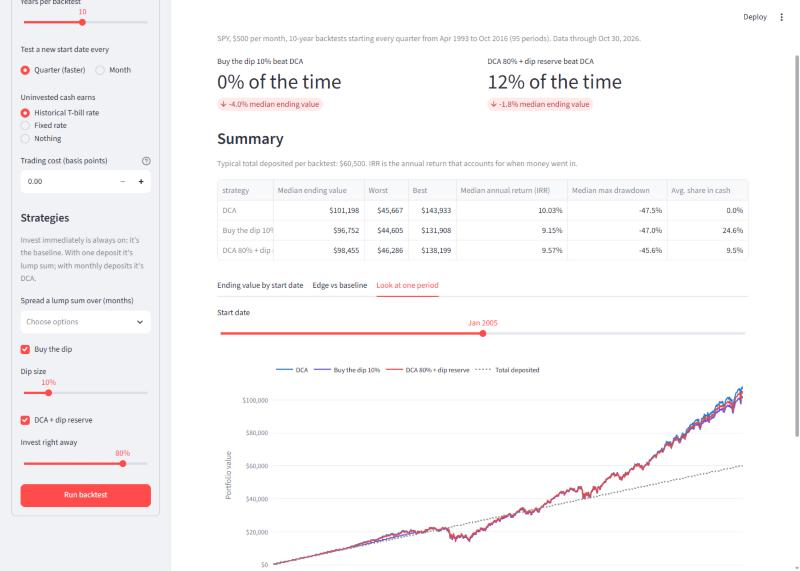
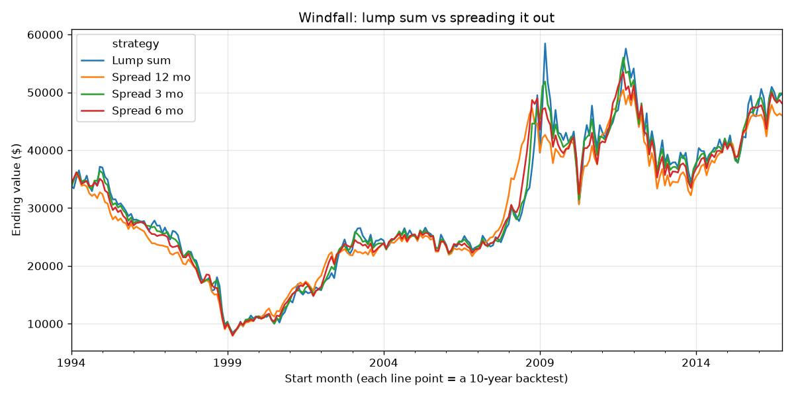

# Strategy Backtester

**Does "buying the dip" actually beat investing every month? Should you invest a
windfall all at once or spread it out?** This project answers questions like these
by testing personal investing strategies against 30+ years of real market data.

Most backtests run a strategy over one period, and the result depends heavily on
whether that period happened to include a crash. This engine runs every strategy
from **every start month in history** and reports how often each one wins.



## Key findings (S&P 500, 10-year periods, 1993–2026)

| Question | Answer |
|---|---|
| Got $12,000 at once: invest it now, or spread it over 12 months? | Investing now won **74%** of the time (median +4.5%) |
| Investing $500/month: wait for 10% dips, or just invest each month? | Investing each month won **100%** of the time |
| Invest 80% each month and save 20% for dips? | Plain monthly investing still won **89%** of the time |

The lump-sum result matches Vanguard's published research (lump sum wins about
two-thirds of the time), which is a useful check that the engine is correct.

**Why waiting loses:** money sitting in cash waiting for a dip misses the market's
gains in the meantime, and those gains usually outweigh the discount from buying low.



## Features

- **4 strategies:** lump sum / dollar-cost averaging, spreading a lump sum over N
  months, buying the dip, and a hybrid that keeps a cash reserve for drops of 10/20/30%
- **Rolling-window analysis** across hundreds of start dates, with win rates and
  head-to-head comparisons
- **Realistic assumptions:** dividend-adjusted prices, historical Treasury bill
  rates on uninvested cash, optional trading costs
- **Proper metrics:** money-weighted return (IRR), time-weighted return,
  volatility, Sharpe ratio, max drawdown
- **Interactive Streamlit dashboard** for any ticker, amount and time horizon
- **Unit-tested engine** (25 tests) run automatically on every push

## Quick start

```bash
pip install -e ".[dev]"
streamlit run app.py                     # dashboard
python -m examples.compare_strategies    # command-line report + charts
python -m pytest                         # tests
```

Data comes from Yahoo Finance (prices) and FRED (3-month T-bill rates) and is
cached in `data/` after the first run.

## How it works

```
backtester/
  data.py        download and cache prices and cash rates
  engine.py      day-by-day simulation loop
  strategies.py  each strategy is one small class
  metrics.py     IRR, time-weighted returns, drawdown, Sharpe
  rolling.py     run every strategy from every start date
app.py           Streamlit dashboard
```

Design decisions:

- **Every strategy gets identical deposits.** Strategies only decide what to do
  with cash that has arrived, so comparisons are fair.
- **No look-ahead bias.** A strategy can only see prices up to the current day.
- **Deposits aren't counted as returns.** Risk metrics use time-weighted returns;
  IRR accounts for when money went in.
- **Adding a strategy doesn't touch the engine.** Write a class with an
  `on_day(ctx)` method that returns buy/sell orders:

```python
class BuyTheDip(Strategy):
    def on_day(self, ctx):
        if drawdown(ctx, self.ticker, 252) <= -self.threshold:
            return [Order(self.ticker, ctx.portfolio.cash)]
        return []
```

## Limitations and next steps

- Taxes aren't modeled yet (tax-loss harvesting is planned)
- SPY data starts in 1993, so 10-year windows cover about three decades
- Trades execute at the daily close
- Planned: rebalancing strategies, multi-asset portfolios, trend following

*Educational project, not investment advice.*
